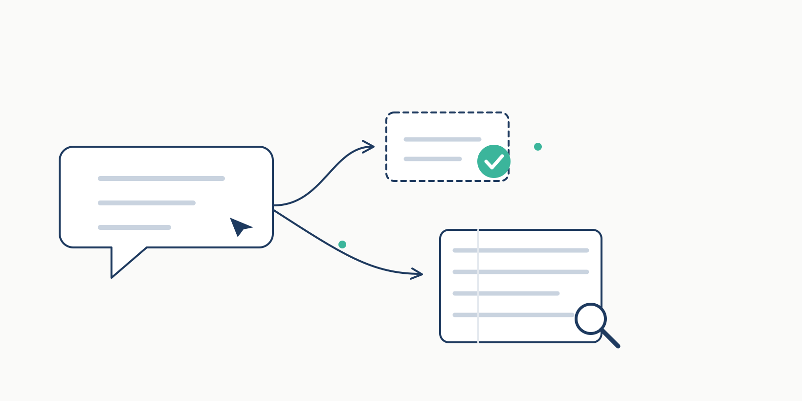
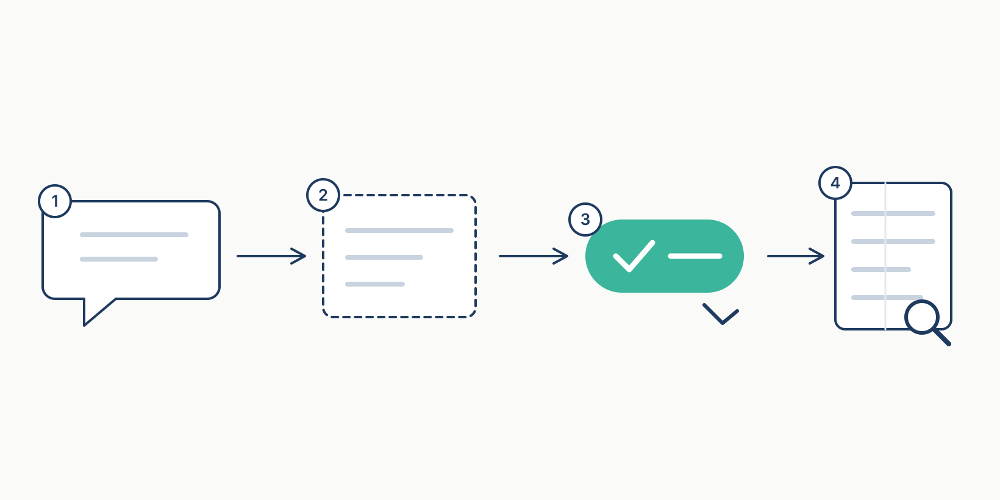

# tabellio-dsh 🧠

<p>
  <a href="https://github.com/yffo/tabellio-dsh/actions/workflows/ci.yml"></a>
  <a href="https://www.npmjs.com/package/tabellio-dsh"></a>
  <a href="LICENSE"></a>
</p>

[English](README.en.md) | 简体中文

**给 DeepSeek Harness 加一个「记得住、但你说了算」的记忆。**

它会在聊天里留意值得留下的约定和偏好，先收进「候选区」；你点一下批准，它才真正记住。之后你问「我们上次怎么定的？」，它会自己想起来。

数据全部存在你电脑上的普通 Markdown 文件里，不联网、不上传；只有显式开启 `judge: llm` 时，候选笔记才会交给宿主模型做一次「相关/不相关」的裁决。

<p align="center">
  
</p>

---

## 为什么要装它

新开一个对话，Agent 就失忆了：你昨天说过的偏好、定过的流程、纠正过的错误，它一概不记得。

市面上的记忆插件大多两种做法：要么什么都不记，要么把整段对话一股脑塞进记忆里——结果不是没帮上忙，就是把无关内容也召回、干扰回答。

tabellio-dsh 走第三条路：**先草稿，后记忆**。它只把「看起来值得记」的话写成候选；你批准了才入库。入库的每条记忆都能查到来源，召回有预算、有上限，不会淹没对话。

## 它和别的记忆插件有什么不一样

- **你批准，它才记。** 自动捕获只写「候选」，不动正式记忆。删除、修改也永远在你手里。
- **召回看得见、说得清。** 设置里的「记忆」页会告诉你上一轮为什么想起（或没想起）什么，而不是黑箱。
- **纯本地、纯文本。** 记忆就是 `~/memory/tabellio` 下的 Markdown 文件，用任何编辑器都能看；换电脑拷走就能用。

## 安装

需要 DeepSeek Harness `0.2.x`。

```bash
dsh plugin --profile desktop add tabellio-dsh
```

装完**重启 DSH**。打开「设置 → 记忆」，能看到笔记数、候选数和库路径就成功了。

> 还在开发版？用本地目录安装：`dsh plugin --profile desktop add /path/to/tabellio-dsh`。

## 第一次用，只做三件事

1. **正常聊天。** 说一句「以后发布前先跑测试」或「我不喜欢太长的回答」。
2. **打开「设置 → 记忆」**，在候选区点「批准入库」。
3. **过几天问它一句**：「我们发布前一般先做什么？」——它会自己想起来。

想跳过对话直接写？「设置 → 记忆」里有一个「直接存一条记忆」的输入框，保存即入库。

就这么多。不需要每次说「请记住」，也不需要配置任何东西。

## 它怎么记住你

```
你说的话
   │  ① 留意约定、偏好、纠错（每轮最多 2 条）
   ▼
候选区 notes/candidates/     ← 只在这里，还没进记忆
   │  ② 你在「记忆」页点批准
   ▼
正式记忆 notes/              ← 本地 Markdown，可搜索、可编辑、可删除
   │  ③ 下次聊到相关话题
   ▼
自动想起（有预算、有上限，闲聊不打扰）
```

<p align="center">
  
</p>

几个你可能会关心的点：

- **不会偷偷调模型。** 默认完全不调用任何模型、不联网。只有你手动打开「模型裁决」开关时，才会用你已经在用的 DSH 模型做一次小判断（默认关闭）。
- **不会把整段对话存下来。** 只挑约定、偏好、纠错这类「值得长期记住」的句子。
- **不会把密码写进去。** 出现明文密码、token 的句子直接跳过；「凭据统一放 1Password」这种策略句才会保留。
- **不会打扰闲聊。** 只有问题像是在问「我们的历史/约定/偏好」时，才会把记忆带进上下文。

## 常见问题

**Q：装完为什么一条记忆都没有？**
它只在出现值得记的话时才产生候选；新库本来就是空的。聊几天就有了。

**Q：为什么候选一直不消失？**
候选需要你批准（或忽略）才会离开候选区。Agent 不会替你批准——这是故意的。

**Q：记忆存在哪里？能备份吗？**
`~/memory/tabellio`。整个目录拷走就是备份；删掉索引也能从 Markdown 重建。

**Q：能关掉自动捕获吗？**
能。设置里把 `capture` 改成 `off`，或只保留 `explicit`（必须说出「记住」才记）。

**Q：会不会拖慢对话？**
召回只在每轮第一条真人消息时做一次，有 500 token 预算和 6 条上限；闲聊直接跳过。

**Q：支持 Claude Code / Cursor 吗？**
核心库和命令行工具支持多个宿主；DSH 插件目前只适配 DSH。其他宿主的适配在路线图上。

## 几个可选开关

普通用户不用动。想微调的话，在 DSH 的 profile 配置里改这几项就够：

| 开关 | 默认 | 一句话 |
|---|---|---|
| `capture` | `assist` | 记什么：`assist` 最省心；`explicit` 只记「记住…」；`off` 关闭 |
| `delivery` | `context` | 怎么送：`context` 静默（推荐）；`notice` 在对话里显示一条提示 |
| `shadow` | `false` | 只记录召回、不注入，用来对比其他记忆插件 |
| `judge` | `off` | 用模型再筛一遍召回，更准但每轮多一次模型调用 |
| `storePath` | `~/memory/tabellio` | 记忆放在哪 |

其余高级配置见[开发者说明](#给开发者)。

> 上表是插件补丁（`cordis.patch.yml`）下发的默认值；配置里不写这些键时，代码内置默认是 `capture: explicit`、`delivery: notice`。

### 模型裁决（可选）

开启 `judge: llm` 后，每轮召回多一次小模型调用：把「问题 + 最多 4 条候选」一起给模型，只留真正回答问题的笔记。默认关闭；模型用宿主当前默认（也可以 `judgeProvider`/`judgeModel` 指定）。

真实模型抽样（本地 Qwen3.6-35B，30 条冻结问句 + 人工 gold）：gold 召回 19/20，judge 后保留 18/19（94.7%），保留笔记里 85.7% 是相关项；1 条 gold 被误杀、1 条无关笔记被留下、1 次格式失败按「失败即放行」回退。这是 2026-10-19 的快照，不是长期承诺。

## 隐私

- 全部本地读写，无网络请求（开启 `judge: llm` 时例外：会调用你自己配置的模型）。
- 不收集任何遥测。
- 明文 Markdown，建议放在你自己的加密磁盘里。

## 给开发者

<details>
<summary>点开：架构、工具面、配置全表、测试与评测</summary>

### 架构

- **核心 `tabellio`**：存储、索引、BM25 + 共现打分、写入闸门、回执、巩固。这个插件只做 DSH 适配，不复制核心逻辑。
- **适配层 `tabellio-dsh`**：`agent/pre-step` 召回、`agent/turn-stopping` 捕获、7 个原生工具、设置面板（HTTP RPC，loopback + Origin 校验；状态/直接写记忆/候选与提案批准/搜索（点标题看全文）/上次召回/模型裁决/最近 7 天周报/全部笔记翻页）。
- 换宿主时核心不动，只换适配层；库目录、写入闸门、召回口径三个入口共用，走查见 [docs/CROSS-HOST.md](docs/CROSS-HOST.md)。

### 工具

`tabellio_recall` / `tabellio_search` / `tabellio_read` / `tabellio_status` / `tabellio_capture` / `tabellio_inbox` / `tabellio_report`（周报：最近 N 天新增了哪些记忆）。工具与 CLI、MCP 共用同一套预算、拒答和写入闸门。

### 配置全表

| 字段 | 默认 | 说明 |
|---|---|---|
| `enabled` | `true` | 关闭后不注册工具、不挂事件 |
| `storePath` | `~/memory/tabellio` | 与 CLI/MCP 同一个库，支持 `~` |
| `autoRecall` | `true` | 每轮首个真人消息召回一次 |
| `shadow` | `false` | 只写回执不注入，用于 A/B |
| `delivery` | `notice` | `notice` 可见通知；`context` 静默上下文 |
| `recallBudgetTokens` | `500` | 召回预算，100–4000 |
| `recallMaxNotes` | `6` | 最多几条，1–20 |
| `recallIntentGate` | `true` | 没有记忆意图的问句不注入 |
| `recallConfidentRelevance` | `0.9` | 首条相关度到这条线时，即使没有意图词也放行 |
| `recallMinCoverage` | `0.33` | 覆盖率闸；长问句会被稀释，默认按对话场景调松 |
| `recallMinScore` | `0.1` | 最低分 |
| `recallMinRelevance` | `0.12` | 最低相关度 |
| `includeCore` | `true` | 是否包含 core 笔记 |
| `minQueryChars` | `4` | 更短消息不召回 |
| `queryChars` | `400` | 超长消息保留头尾 |
| `refreshSeconds` | `30` | 重扫库间隔；0 表示每次事件重扫 |
| `capture` | `explicit` | `explicit` / `implicit` / `assist` / `off` |
| `maxCandidatesPerTurn` | `2` | 每轮候选上限，1–5 |
| `captureMaxSentenceChars` | `240` | 单句上限，40–1000 |
| `judge` | `off` | `off` / `llm` |
| `judgeProvider` / `judgeModel` | 空 | 留空用宿主默认模型 |
| `judgeTimeoutMs` | `4000` | 裁决超时，500–15000，超时回退词面命中 |

### 测试与评测

```bash
npm test                      # 71 个单元/集成用例
node tests/acceptance.mjs     # 30 条功能验收
node tools/cross-host-demo.mjs  # 跨宿主 API 走查（临时库）
python3 tools/blind-eval.py <外部数据集.json>  # 冻结查询的召回盲测（数据集含个人记忆，不入库）
node tools/judge-eval.mjs <带 gold 的查询集.json>  # 真实模型裁判抽样（本地/任意 OpenAI 兼容端点）
```

发布前四路独立测试报告归档在 `~/yffto/archive/2026-10/scratch/tabellio-dsh-validation/final/`。

### 边界

- 不自动批准候选，不自动合并/衰减/删除笔记。
- 不伪造 DSH 生命周期事件。
- 不联网（`judge: llm` 除外）。

</details>

## License

MIT
